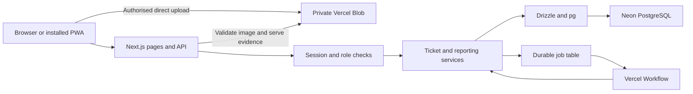
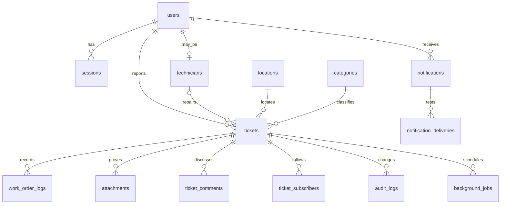

# CampusFix programme manual

This manual explains the implemented source and database. It is for group members who install, maintain, test, or extend CampusFix. Read [README](../README.md) for setup and demo accounts. The full source is supplied in the project and in [Programme Source Listing](Programme_Source_Listing.md). No credentials are included in that listing.

## System structure

Local mode uses the same Next.js source, PostgreSQL schema, and services. It replaces Blob with private files in `.data/uploads`. A polling worker executes database jobs. PostgreSQL can run in Docker or as a private native process. The local worker makes the presentation copy independent of hosted services.

The browser renders React screens. It sends JSON to `/api`. The server reads the session from a secure cookie and checks the role and ticket access. The services use parameterised Drizzle SQL. Ticket mutations run in PostgreSQL transactions. The browser does not connect to PostgreSQL or receive a database secret.

## Source map

| File or folder | Purpose |
|---|---|
| src/app | Server pages, API route, global styles, help page |
| src/components | Forms, ticket screens, management screens, navigation |
| src/components/ui | Shared button, form, notice, and status components |
| src/lib/auth.ts | Login, lock checks, sessions, logout |
| src/lib/domain.ts | Shared input schemas, types, labels, access rules |
| src/lib/policies.ts | Small assessed decision routines |
| src/lib/tickets.ts | Creation, dispatch, work, closure, merge, audit |
| src/lib/storage.ts | Local files, private Blob, signature and decode checks |
| src/lib/notifications.ts | In-app notices and test delivery records |
| src/lib/reports.ts | Dashboard, reporting queries, safe CSV |
| src/lib/reference.ts | Accounts, availability, category and location changes |
| src/lib/jobs.ts | Durable job execution and Workflow launch |
| src/lib/offline.ts | IndexedDB drafts and submission queue |
| src/workflows/maintenance.ts | Durable sleep and job step |
| src/db | Pool, typed Drizzle schema, query helpers |
| db/migrations | Ordered SQL migrations |
| scripts | Database, local server, evidence, load, and deployment helpers |
| tests | Unit, database, and browser tests |
| public | PWA manifest, icons, service worker, offline help |

## Build tools

The lockfile fixes the installed dependency tree. Core versions are Next.js 16.4.3, React 19.3.0, TypeScript 5, Drizzle 0.45.4, pg 8.23.1, Zod 4.6.7, Blob 2.8.2, and Workflow 5.2.3. Read `package.json` and `package-lock.json` for exact versions and overrides. UI components use Tailwind, Radix primitives, and the shadcn component pattern. Local PostgreSQL 16.15 was tested.

`npm run build` compiles both the application and Workflow routes. `npm start` serves the production output. `npm run local` starts the database if required, prepares it, and starts the development server and local worker. `npm run verify` runs type checks, ESLint, and unit/database tests. The GitHub Actions file describes repeatable Linux checks. No remote CI pass is claimed unless an actual run is recorded.

## Configuration

| Variable | Use |
|---|---|
| DATABASE_URL | Private PostgreSQL connection string |
| TEST_DATABASE_URL | Separate campusfix_test database for integration tests |
| APP_URL | Optional accepted application origin |
| STORAGE_DRIVER | local or vercel |
| LOCAL_STORAGE_DIR | Private local file root, default .data/uploads |
| BLOB_READ_WRITE_TOKEN | Server-only private Blob token |
| DEMO_MODE | Shows course demonstration controls |
| DEMO_PASSWORD | Password used when seeding demo accounts |
| CRON_SECRET | Secret bearer token for hosted job recovery |

No setting with a database or Blob secret has a `NEXT_PUBLIC_` prefix. Environment files, local data, and generated evidence are excluded from Vercel uploads. File tracing also excludes local data and environment files. Use different files for local and cloud settings.

## Database design

Migration `0001_course_baseline.sql` is a copy of the supplied course SQL. Migration `0002_application.sql` adds the implemented fields and tables. The migration runner takes an advisory lock, records completed files, and applies each new file in a transaction. It can be run again without applying the same migration twice. Do not edit an applied migration. Add another migration for a later schema change.

There are 15 application and migration tables, four enum types, a ticket number sequence, and two baseline reporting views.

| Table | Key and main data | Relations |
|---|---|---|
| users | user_id UUID; unique email and institutional ID; bcrypt hash; role; preferences; lock expiry; active flag | Owns sessions, reports, comments, notices |
| technicians | tech_id UUID; trade; availability; active_workload | tech_id references users |
| locations | location_id UUID; faculty; building; room; active flag | Used by tickets |
| categories | category_id UUID; name; trade; default priority; active flag | Used by tickets |
| tickets | ticket_id text; title; description; priority; state; UTC dates; version; unique submission key | Reporter, location, category, technician, optional main ticket |
| ticket_subscribers | Composite ticket and user key | Explicit followers |
| work_order_logs | UUID; notes; parts; labour minutes; created time | Ticket and technician |
| audit_logs | UUID; event; details; actor; ticket; time | Append-only event history |
| sessions | UUID; unique SHA-256 token hash; user; expiry | Raw token stays in cookie only |
| attachments | UUID; owner; optional ticket; BEFORE or AFTER; private key; type; bytes; verified flag | File content stays outside the database |
| ticket_comments | UUID; ticket; author; text; time | Ticket discussion |
| notifications | UUID; user; ticket; event; body; read time | In-app view and delivery parent |
| notification_deliveries | UUID; channel; state; attempts; last error | Unique notification and channel |
| background_jobs | UUID; kind; ticket and version; due time; state; attempts; Workflow run ID | Durable deferred work |
| campusfix_migrations | File name; applied time | Migration history |

The source SQL is the exact field-level data dictionary. `src/db/schema.ts` supplies the matching typed schema. UUID fields never receive a text placeholder for an unavailable technician. A missing technician is NULL. Timestamp fields use TIMESTAMPTZ. Calendar report filters use Jamaica midnight boundaries. The audit trigger rejects UPDATE and DELETE. Application account management deactivates records rather than deleting audit-linked accounts.

Important constraints include description length 15 to 500, title length 1 to 150, attachment bytes 1 to 4,500,000, work minutes 0 to 1,440, assigned technician presence for active assigned states, and completion notes, completion time, and after-proof presence for Completed and Closed states. Indexes cover active duplicate checks, sessions, subscribers, notifications, audit lookups, and due jobs.

## Module inputs and outputs

| Module | Input | Processing | Output |
|---|---|---|---|
| Authentication | Identifier and password | Validate, row lock, account policy, bcrypt, lock counter, session hash | Session cookie or controlled error |
| Reporting | Location, category, text, urgency, optional attachment, submission key | Validate, verify owner, advisory lock, insert, audit, notify | Unique ticket number |
| Dispatch | Ticket version, priority, technician or auto | Check role, trade, availability, row lock, deadline, workload | Assigned or Pending ticket |
| Repair | Version, work record, notes, after proof | Check owner and state, claim proof, update work, recalculate workload | In progress, Completed, disputed, or Closed ticket |
| Notifications | Ticket event and recipient preferences | Insert notice and delivery jobs in transaction, retry test transport | In-app notice and labelled delivery records |
| Reports | Manager session, date and area filters | Aggregate scoped data, compute durations and SLA, quote CSV | Screen, CSV, printable page |

## Processing narratives

### Authentication

Read the account in a transaction with a row lock. Reject an inactive account or a future lock. Check the bcrypt hash. After five failed attempts, set lock expiry to 30 minutes. An expired lock starts a fresh failure count. On success, clear failures and store a SHA-256 hash of a random 32-byte token. Put the raw token in an HttpOnly, SameSite=Lax cookie. Hosted production cookies are Secure. Local HTTP loopback uses the same session checks without the Secure flag so Safari can use the presentation copy. Each request reads the current account role from the database. Deactivation revokes sessions.

### Report creation and offline retry

Validate the shared Zod schema. Check active category and location records. Take an advisory lock on the submission key. If the key already exists for this user, return its ticket number. A different user cannot obtain that result. Verify the attachment owner, phase, and decoded state. Insert the ticket, attach the photo, add the audit event, and create notices in one transaction. A failed step rolls back the report.

The client saves an IndexedDB draft or queued submission with its owner and stable UUID. Reconnect processing checks `/api/session`. It sends only the signed-in owner's queue. It records a successful photo ID before ticket retry. It removes the queue item only after the server confirms the ticket. A full offline navigation displays help; private HTML and API data are not cached.

### Dispatch

Check that the actor is facilities staff. Lock the ticket and compare its version. Take a trade advisory lock. For automatic selection, count actual active jobs for each available qualified technician. Choose the least loaded candidate. Set the deadline from the original submission time and selected priority. If there is no candidate, keep Pending with a NULL technician. Recalculate affected workloads under technician row locks. Add audit and notifications before commit.

### Work and completion

Only the assigned technician can start or log work. Completion checks technician identity, In progress state, and verified AFTER proof. Claim the attachment in the same transaction. Store notes and resolved time. Change state to Completed, update workload, and schedule closure for resolved time plus 72 hours. The reporter can close or dispute. A dispute clears completion data and returns In progress. A delayed closure checks state, elapsed time, and version again, so it cannot close a changed ticket.

### Duplicate merge

Suggestions use the same category and exact location within 12 hours. Suggestions return limited public metadata. Following needs an explicit action. Facilities staff can merge matching reports after submission. The merge lock prevents opposing concurrent merges. The operation moves followers, marks the extra report Duplicate, updates workload, and writes audit records in one transaction.

### Notifications and reports

Ticket events add notices and EMAIL/SMS test delivery rows in the ticket transaction. Workers use locked batches so concurrent workers do not claim the same delivery. Successful records use TEST_RECORDED. The test transport sends no external messages. Failure records keep attempt and error data. Reports compute duration from created_at to resolved_at. Summary denominators exclude Duplicate and Rejected records. CSV quoting handles commas, quotes, and formula prefixes.

The exact pseudocode, source routines, control flow graphs, three complexity methods, and feasible independent paths are in [White Box Tests](White_Box_Tests.md).

## API interface

All responses use JSON unless stated otherwise. Read routes require a valid session except health. Mutation routes check the request origin, input schema, role, and record access. The API uses no-store for private data.

| Method and path | Purpose |
|---|---|
| POST /api/auth/login or logout | Session entry and exit |
| GET /api/session | Current account |
| GET /api/reference | Allowed reference data and storage mode |
| GET /api/dashboard | Role-scoped overview |
| GET or POST /api/tickets | Filtered list or idempotent creation |
| GET /api/tickets/duplicates | Limited duplicate suggestions |
| GET /api/tickets/{id} | Authorised ticket detail |
| POST /api/tickets/{id}/actions | Dispatch, work, review, follow, comment, merge, reject |
| POST /api/uploads | Local multipart photo validation |
| POST /api/uploads/prepare | Create private cloud upload intent |
| POST /api/uploads/blob | Blob SDK token and verified callback |
| POST /api/uploads/confirm | Decode cloud upload before attachment |
| GET /api/attachments/{id} | Authorised private photo bytes |
| GET or PATCH /api/notifications | View or mark read |
| PATCH /api/settings | Notification preferences |
| GET /api/reports | Facilities aggregates |
| GET /api/reports/export | Quoted CSV download |
| GET, POST, PATCH /api/admin/users | Administrator account actions |
| POST /api/admin/reference | Administrator reference changes |
| GET /api/admin/audit | Administrator audit view |
| GET /api/admin/deliveries | Facilities test delivery view |
| GET /api/health | Database connection check without secrets |
| GET /api/jobs/recover | CRON_SECRET-protected job recovery |

Typical controlled statuses are 400 for invalid data, 401 for sign-in, 403 for forbidden access, 404 for missing records, 409 for a stale version or invalid transition, and 429 for an account lock. Unexpected failures return a general server error. Inspect server logs for diagnosis. Never copy secrets into logs or course screenshots.

## Storage protocol

Local uploads pass through the Node API. Hosted uploads go directly from the browser to private Blob using a short-lived server-authorised token. The token fixes type, size, path, and owner. The confirm route checks Blob size, signature, and Sharp decoding, then re-encodes the file. It marks the record verified only after this step. Ticket services accept verified records of the correct owner and phase. Private bytes are served through an access-checked API. This implements image validation, not malware scanning.

## Job recovery and operations

Each job records its purpose, due time, attempts, and Workflow run ID. Vercel launches a Workflow after a ticket request commits. The Workflow sleeps until its due time and executes a step. The daily recovery route handles pending due jobs and orphan photos. Local mode polls the same table. Closure checks are idempotent and version guarded. Delivery rows have a unique channel key and locked processing.

If a provider is unavailable, keep the durable records and retry after service recovery. Check the job error and attempt count. Do not reset a job or alter a ticket directly without a recorded maintenance reason. Free plan quotas can delay processing. This build does not claim guaranteed timing or uptime.

## Maintenance and recovery

Run migrations before a release. Run type, lint, unit, database, and browser checks. Build locally, deploy, then check health, login, private upload, and the repair flow. Keep the previous Vercel deployment available for application rollback. A schema change needs its own forward recovery plan; an application rollback does not undo database changes.

Back up database rows and photo files together. Restore into a separate environment first. Check ticket counts, login, history, attachments, workload totals, and job recovery. The recorded Docker check restarts both PostgreSQL and the application and verifies a persisted ticket, session, and image hash. See [persistence evidence](evidence/persistence.json).

Do not use the public demo credentials for real campus records. Official university sign-in, live message delivery, a full campus pilot, malware scanning, and a formal operational backup policy are later work.
