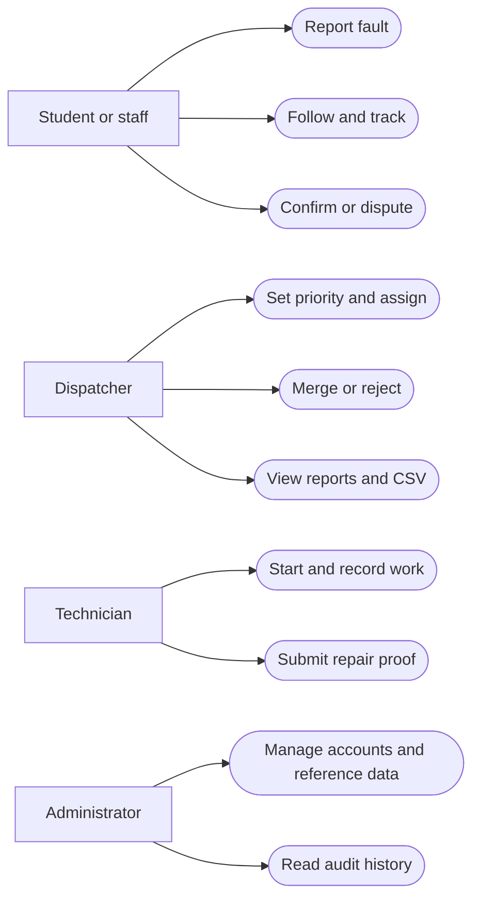
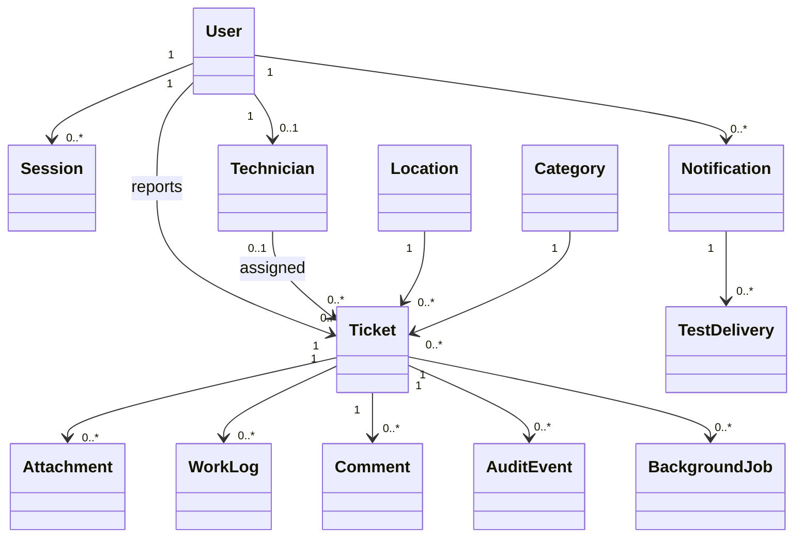
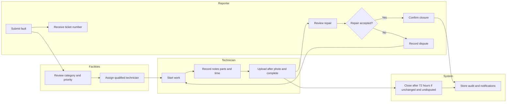

# CampusFix software implementation report

CampusFix is a working web application for the CIT4001 Software Implementation and Testing group project. It supports campus fault reports from submission through repair and closure. This report describes the delivered implementation and its recorded tests. It replaces the unsupported results in the parent draft for this build. The parent course documents remain intact.

## Course and project scope

The syllabus continues the earlier design course with software construction, testing, documentation, and demonstration. The two assignment guides have the same content. They require a development report, programme manual with source and database design, and user manual with colour screenshots. CampusFix follows the fault reporting project in Milestone One.

The delivered scope includes login, database role checks, account locks, fault reporting, private photos, duplicate suggestions and merges, dispatch, technician work, repair proof, dispute and closure, notifications, reports, administration, PWA installation support, and offline drafts. A local PostgreSQL copy supports the demonstration. A Vercel deployment supports remote review.

Official university sign-in and live email or SMS were not part of this build. No campus approval, live pilot, completed training session, malware scan, or uptime guarantee is claimed.

## Users and use cases

| User | Implemented use cases |
|---|---|
| Student and staff reporter | Sign in, report a fault, add a photo, follow a matching report, track progress, comment, confirm or dispute |
| Technician | View assigned work, start work, record parts and time, upload after proof, complete a repair |
| Dispatcher | Review work, set priority, assign or reassign, choose automatic allocation, merge duplicates, reject invalid work, view reports |
| Administrator | All facilities actions, create and manage accounts, set technician availability, manage reference data, review audit events |

## Design and architecture

Next.js and TypeScript provide server pages, React forms, and the API in one codebase. Tailwind and accessible shared components provide a consistent interface. Zod checks shared input rules. PostgreSQL stores relational records. Drizzle supplies typed, parameterised SQL. Sharp validates and cleans images. Private Blob stores hosted evidence. Vercel Workflows execute durable delayed tasks. The local system replaces hosted storage and job execution with private files and a polling worker.

The design keeps the database and file tokens on the server. Every private route checks a database session. Role and ticket access checks also run in the services. A transaction joins ticket state, workload, audit history, and notice creation. Optimistic versions reject stale browser actions. Row and advisory locks protect competing updates and allocation.

The database has 15 tables including migration history. The first migration preserves the supplied schema. The second adds sessions, lock expiry, versions, idempotency, private attachments, comments, notices, test deliveries, and jobs. The field dictionary, relationships, API interface, configuration, and processing narratives are in the [Programme Manual](CampusFix_Programme_Manual.md). The full code is in the [Source Listing](Programme_Source_Listing.md).

## Repair process and swimlanes

The normal path is Pending, Assigned, In progress, Completed, Closed. A duplicate or rejected report has a recorded review reason. No technician leaves the report Pending. The default and selected priorities use 4, 24, or 72 hours from the original submission. Dates are stored in UTC and displayed in Jamaica time. A dispute returns work to In progress and prevents an old closure job from closing the new version.

## Interface implementation

The interface uses a campus service layout with a dark green navigation panel, clear labels, visible priorities, and text status names. Report forms use an exact faculty, building, and room hierarchy. Technician controls work on a phone. Loading, empty, error, conflict, and queued states explain the next action. Keyboard tests and axe checks cover the screens named in the browser suite. Actual colour screenshots appear in the [User Manual](CampusFix_User_Manual.md).

The PWA includes a manifest, install icons, service worker, static asset cache, and offline help. IndexedDB stores per-account drafts and queued reports. A form already open can queue a report during a lost connection. Session checks run before reconnect submission. The app does not cache private API data or authenticated page HTML. A full offline navigation shows help, then the user reconnects to restore the draft form.

## Implementation method

The build used an incremental method. First, the database and access controls established a working foundation. Next, one report moved through dispatch, work, proof, and closure. Reports, administration, duplicate handling, and offline support extended that path. Automated tests were added around business decisions and database transactions. Browser checks then exercised the actual user interface in local and hosted environments.

This method made each release reviewable and allowed controlled defects to be corrected before final evidence was recorded. No historical team dates or personal contributions were invented. The group should add its actual member IDs and contribution records to the submitted cover sheet.

## Testing method and results

Tests include white-box basis paths, black-box partitions and boundaries, PostgreSQL service integration, browser role workflows, private storage, failed delivery retry, concurrency, duplicate handling, phone layout, keyboard input, offline recovery, persistence after restart, and measured performance. See [Test Plan](Test_Plan.md) and [Requirements Traceability](Requirements_Traceability.md).

Six production decision routines have source-checked control flow graphs. [White Box Tests](White_Box_Tests.md) shows edges and nodes, predicate count plus one, and graph regions for each. It lists feasible independent paths and matching test cases. These are routine-level complexity measures. They are not complexity claims for whole service files.

The final machine-readable results and measured counts are in [Recorded Test Results](evidence/Test_Results.md). Use that generated file for exact totals. Chromium and WebKit completed the local repair and recovery scenarios. Hosted Chromium completed the same five scenarios with real private Blob uploads. The Firefox binary supplied for this PC could not start because Windows reported a missing side-by-side mozglue assembly. A fresh browser download did not correct that system failure. Firefox application results are therefore not claimed.

The local production load test sent 500 simultaneous authenticated dashboard requests from one account. It recorded no failed requests. The 95th percentile API time was 1,342 ms, below the stated 2,000 ms target. The joined database query was 1 ms at the 95th percentile over 100 samples. Five browser dashboard loads had a 435 ms 95th percentile. The test used a Ryzen 5 7535HS, 12 logical CPUs, 31 GB reported RAM, Windows, Node 26.12.1, and PostgreSQL 16.15. The small seeded database and one-account load limit these results. They do not establish production capacity.

The isolated Docker check created a real ticket and PNG, read them through the API, stopped the application, restarted PostgreSQL, and started a new application process. The same session, ticket, attachment metadata, and image hash remained valid. See [persistence.json](evidence/persistence.json).

## Recorded defects and corrections

| Finding | Correction | Evidence |
|---|---|---|
| Initial small text and low contrast failed axe | Increased small type and corrected light-surface text contrast | Final browser axe attachments |
| Duplicate suggestion changed after a browser test clicked too early | Test waits for the response and visible explicit choice | Local and hosted full workflow |
| Short browser timeout interrupted a WebKit accessibility scan | Allowed a measured 180-second scenario limit | WebKit completed with recorded duration |
| Ticket number padding could truncate values above 9999 | Preserved the full sequence value | Regression test with a sequence above 10000 |
| Report calendar filters used UTC midnight | Changed boundaries to Jamaica midnight | Database and CSV date regression |
| Dynamic local file reads expanded production tracing | Excluded local files and environment data from function tracing | Clean production build |
| WebKit rejected Secure cookies on local HTTP production | Allowed local loopback cookies while keeping hosted cookies Secure | Final local production and hosted browser checks |
| Firefox could not launch on Windows | Reinstalled the browser and recorded the remaining environment limit | Browser environment evidence |

These are findings from this build. They are not the draft report's unverified defect history.

## Deployment and recovery

The live course copy is at https://campusfix-seven-iota.vercel.app. The `campusfix7` team uses Vercel Hobby. Neon uses the Free plan. Blob is private and hosted in iad1. Workflow jobs record their run IDs. The deployed test delivery jobs reached Done and stored TEST_RECORDED channel rows. The 72-hour closure Workflow was scheduled. The service's elapsed-time closure rule was tested without claiming that a live 72-hour wait had already finished.

Docker is available as the team database option. The native local copy remains useful when Docker is unavailable. Both use PostgreSQL 16 and the same migration and seed commands. Keep the database and private photo backups together. The [Demonstration Script](Demonstration_Script.md) gives a repeatable role sequence and recovery checks.

## Training and acceptance

Training and user acceptance have not been performed with campus users. [Training and UAT](Training_and_UAT.md) provides a session plan, role tasks, feedback form, and sign-off fields. The group must record actual people, dates, observations, and results after sessions occur. A phased campus pilot is a proposed next step, subject to university approval.

## Future work and limits

Later work includes official university identity integration, approved live email and SMS, human accessibility testing, a completed Firefox run on a working host, campus user acceptance, a formal pilot, production capacity testing, and a tested operational backup policy. Public demo accounts must be replaced before real records are used. Free plan quotas can pause or delay services.

## Sources

Course sources: Assignment_Guide.docx, Assignment_Guide (2).docx, Software_ImplTest_Syllabus (2).doc, Milestone One.docx, and the supplied CampusFix SQL. The parent report and manual were treated as draft requirements, not test evidence. Lecture materials informed the white-box, black-box, integration, training, and implementation sections.

Technical references: [Next.js documentation](https://nextjs.org/docs), [Drizzle documentation](https://orm.drizzle.team/docs/overview), [PostgreSQL documentation](https://www.postgresql.org/docs/16/), [Vercel private Blob](https://vercel.com/docs/vercel-blob/private-storage), and [Vercel Workflows](https://vercel.com/docs/workflows). Exact installed versions and source are supplied with this application.
