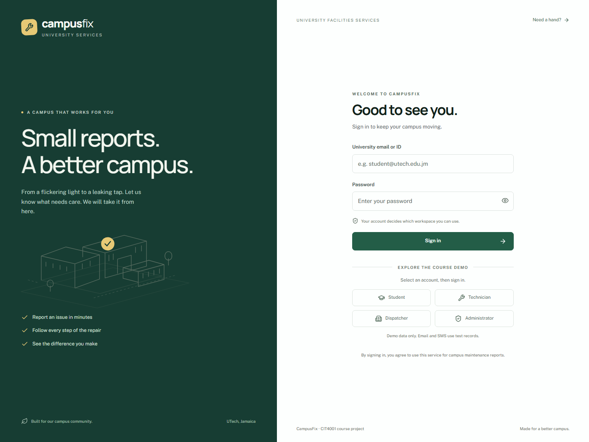
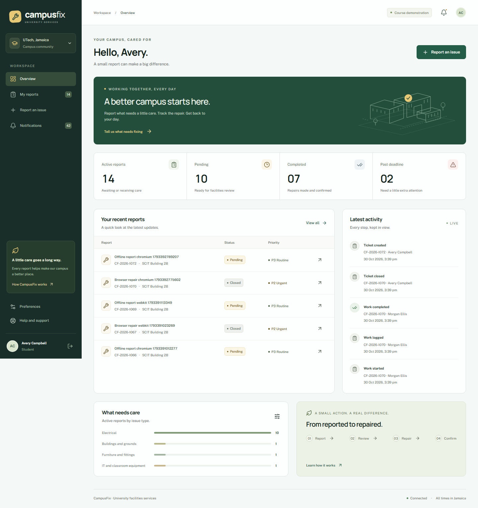
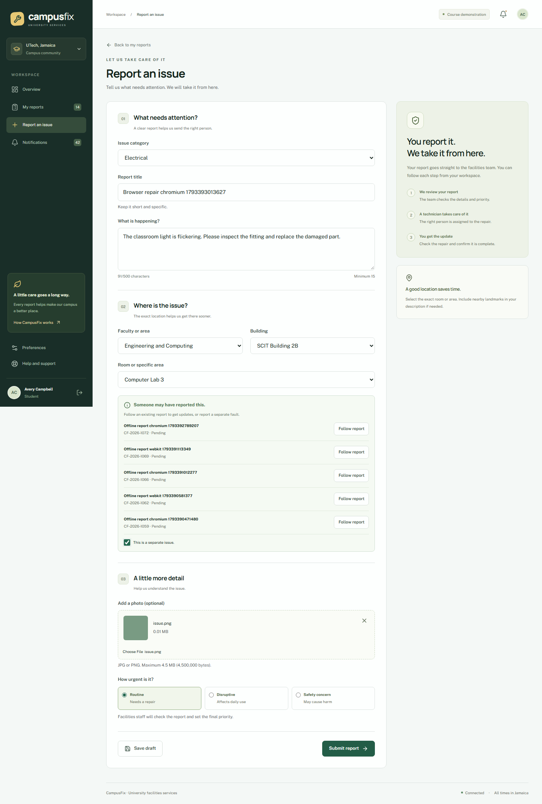
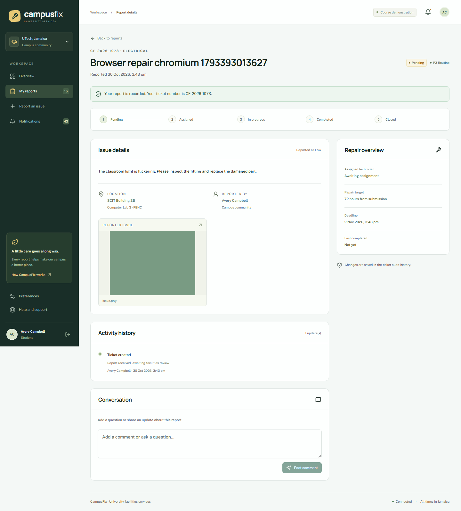
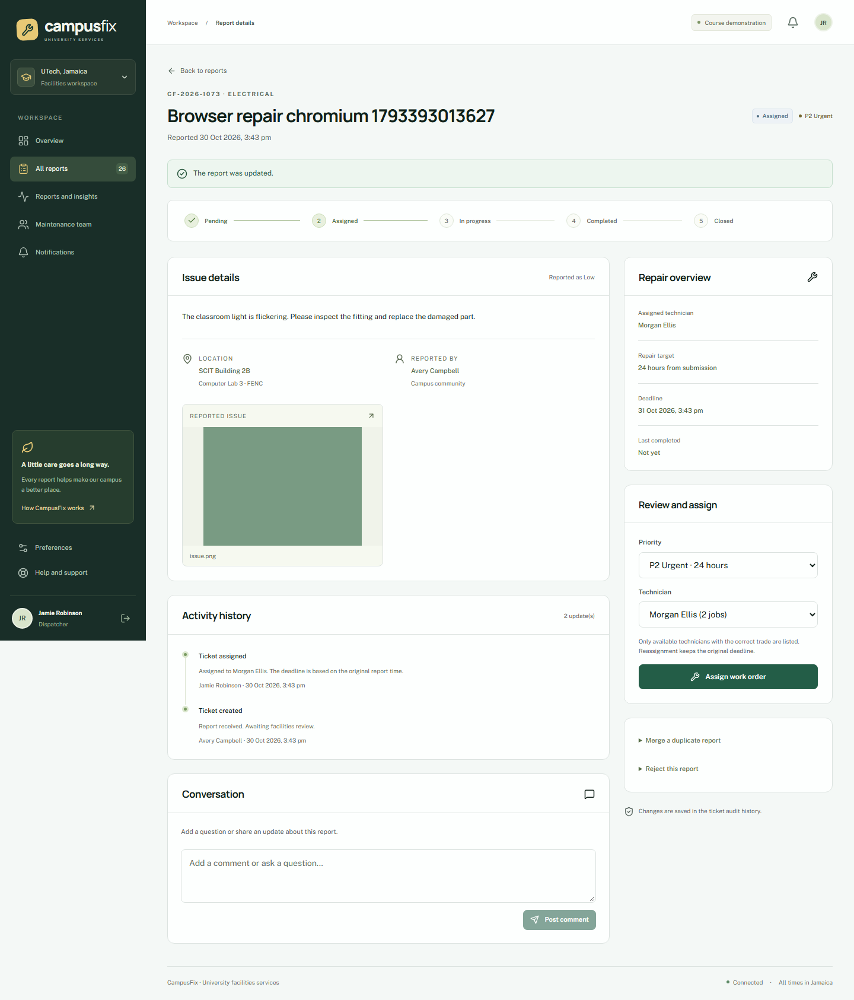
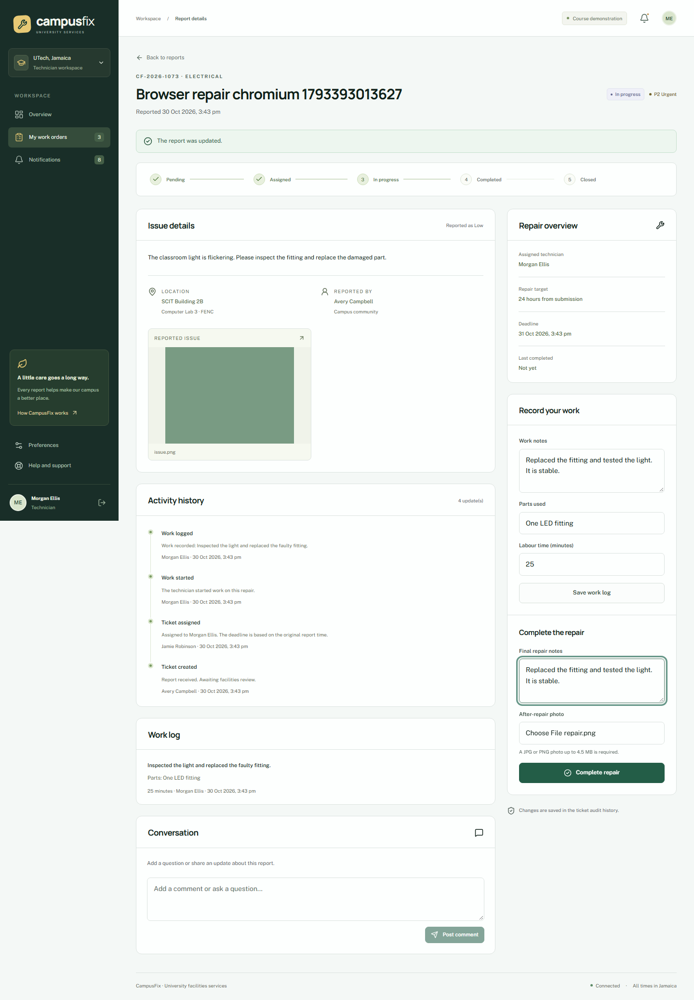
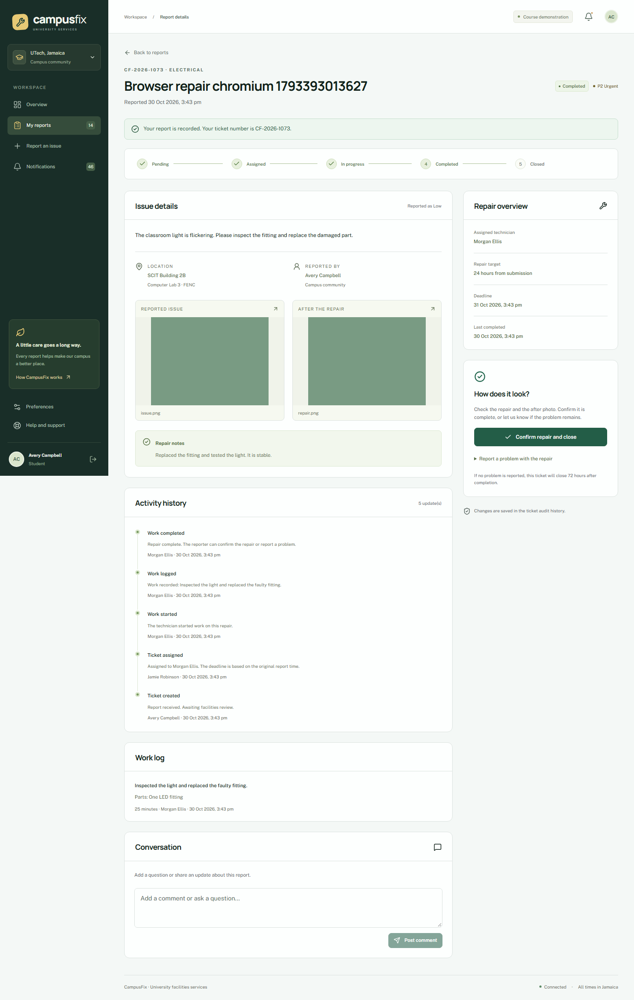
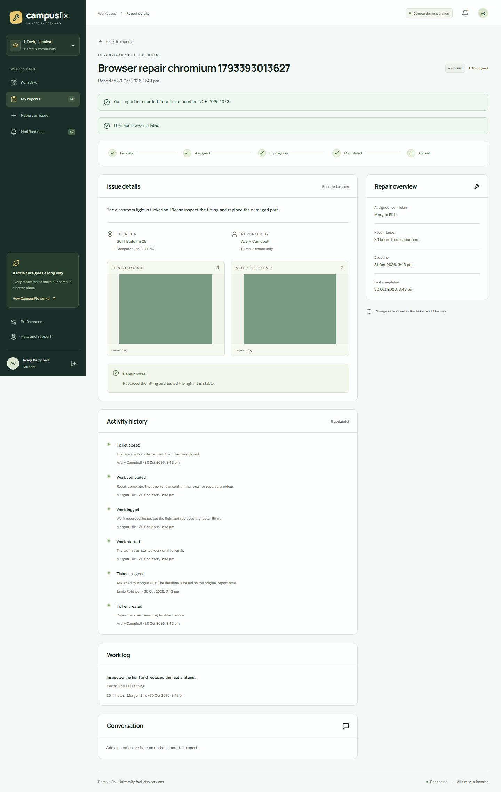
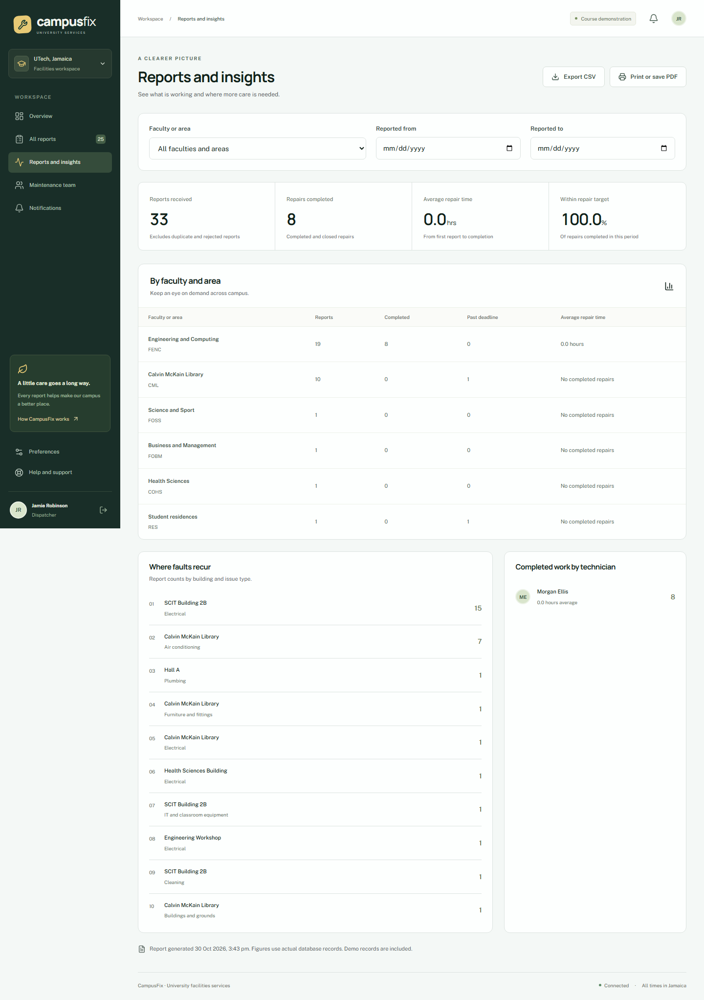
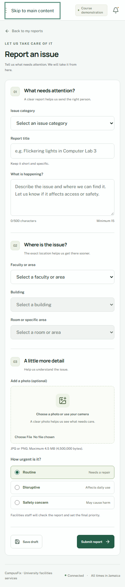

# CampusFix user manual

This manual explains the CampusFix course demonstration. It covers reporting, dispatch, repairs, reports, and accounts. Use the [demo accounts](../README.md). Screenshots show the implemented application. Automated repair tests use generated sample photos.

## Open CampusFix

Open https://campusfix-seven-iota.vercel.app, or http://localhost:3000 for the running local copy. Use a current desktop or phone browser. Allow cookies and local storage. The app has no official university login connection. Use a demo account or an account that the demonstration administrator created.

## Sign in

1. Enter the account email or university ID.
2. Enter the password.
3. Select **Sign in**.

Demo role buttons fill the account fields. You must still select Sign in. Five failed attempts lock an account for 30 minutes. An administrator can unlock it. Sessions expire after two hours. Sign out on shared devices.

## Check the overview

The overview shows active, pending, completed, and overdue reports. Open a recent report to see its state. Students and staff see their own reports and reports they follow. Technicians see assigned jobs. Facilities staff see the work queue.

## Report a fault

1. Select **Report an issue**.
2. Select the category.
3. Enter a title of 1 to 150 characters.
4. Describe the fault in 15 to 500 characters. Explain what failed and how it affects the area.
5. Select the faculty or area, building, and room.
6. Select urgency. The dispatcher sets the final priority.
7. Add an optional JPG or PNG photo, up to 4,500,000 bytes. Invalid image content is rejected even if its size is allowed.
8. Review similar reports. Follow an existing report if it describes the same fault. Select **This is a separate issue** only when you need another report.
9. Select **Submit report**. Keep the ticket number.

Suggestions use active reports from the same location and category within 12 hours. They show limited fault details, without another person's photos or comments. Only facilities staff can confirm a merge.

## Track a report

Open **My reports**. Search by ticket number or title. Use state, priority, category, and area filters. Open a ticket for details, comments, photos, and activity history. Displayed dates use Jamaica time.

| State | Meaning |
|---|---|
| Pending | Review is needed, or no technician is available. |
| Assigned | A technician has the job. |
| In progress | Work has started. |
| Completed | Repair notes and an after photo are ready for review. |
| Closed | The reporter confirmed the repair, or 72 hours passed without a dispute. |
| Duplicate | Facilities staff linked the report to a main ticket. |
| Rejected | Facilities staff rejected it and recorded a reason. |

Add comments from an open ticket. Other authorised ticket users can read them. Do not include passwords or personal records. Audit history cannot be edited.

## Dispatch work

Sign in as a dispatcher or administrator. Open a report from the queue. Check its category and location. Set P1, P2, or P3. Select a qualified technician, or choose automatic selection. Save the assignment.

Automatic selection checks trade, account status, availability, and current active workload. If none is available, the report stays Pending and unassigned. P1 is due in 4 hours, P2 in 24 hours, and P3 in 72 hours from the original report time. Reassignment does not reset the clock. A priority change also uses the original report time.

To merge a duplicate, open the extra report and enter the main ticket number and a reason. The category and location must match. Followers move to the main ticket. To reject a report, enter a reason. Both actions appear in history.

If another person changes the ticket, the app shows a conflict. Reload it and review the latest state before repeating an action.

## Record a repair

Sign in as the assigned technician and open the job.

1. Start work.
2. Record notes, parts, and labour minutes. Each work record allows 0 to 1,440 minutes.
3. Save the work record.
4. Enter completion notes of at least 10 characters.
5. Upload a valid JPG or PNG after photo.
6. Submit completion.

Completion is blocked until work starts and valid proof is present. A technician cannot change another technician's job.

## Review a repair

The original reporter checks the completed ticket, notes, and after photo. Confirm the repair if it is complete. The ticket becomes Closed.

If the fault remains, select **Report a problem** and enter a reason of at least 10 characters. Work returns to In progress. The next completion needs fresh proof. If no dispute is received, a background check closes the repair after 72 hours. Keep the local worker running for this check on the presentation copy.

## View reports

Facilities staff can open **Reports and insights** and filter by area and date. Mean repair time runs from submission to technician completion. SLA compliance compares completion with the deadline. Summary measures exclude Duplicate and Rejected tickets. The CSV includes the matching ticket records for review.

Select **Export CSV** to download records. Select **Print or save PDF** to open the browser print dialog.

## Manage accounts and the campus directory

Administrators can create, activate, deactivate, and unlock accounts. Select a role and password for each new account. Technician accounts also need a trade. Set technician availability from account management. Reassign active work before deactivating a technician. Administrators cannot deactivate their own account.

Use **Campus directory** to add, edit, or deactivate categories and locations. Old ticket links remain. Use **Audit history** to review recorded events. Facilities staff can open **Message delivery**. **Test recorded** means that a delivery test was stored. No email or SMS was sent.

## Set preferences

Open **Preferences**. Set email, SMS, and in-app choices, then save. Email and SMS choices control test records in this build. In-app alerts appear under Notifications.

## Use a phone or install the app

Open the same address on a phone. Use the menu button for navigation. Status and priority use text as well as colour. If your browser offers it, select **Install app** or **Add to Home Screen**. The exact command depends on the browser. Installation does not remove the need for an active session.

## Save a draft or work through a lost connection

Select **Save draft** to store a report in this browser for your account. It returns when you reopen the form while connected.

If a form is already open when the connection stops, Submit report puts it in the local queue. Keep the app open, or return when connected. The app checks the session before it sends queued work. If the session expired, sign in as the same account. Retries use the same submission key and create one ticket.

A full page reload while offline shows offline help. Private ticket pages and API data are not cached. Drafts remain on the device, but a connection is needed to open the authenticated form again. Clearing browser data removes local drafts and queued reports. Drafts do not move between devices or browser profiles.

## Resolve common problems

| Symptom | Action |
|---|---|
| Account locked | Wait 30 minutes or ask the administrator to unlock it. |
| Session expired | Sign in again with the account that owns the queued reports. |
| Invalid photo | Select a real JPG or PNG. Check size and dimensions. |
| No technician | Leave the ticket Pending for later assignment. |
| Ticket changed | Reload, review, and repeat the action if it still applies. |
| Missing draft | Check your account and browser profile. |
| No email or SMS | This build stores test deliveries only. |
| Local app unavailable | Start the database, web server, and worker. See README. |

Ask the group member who runs the demonstration for account help. This project has no live campus support desk or emergency response service.
