# White-box test evidence

Scope: one production decision routine from each assessed module. These graphs do not describe the complexity of the whole application. The routines are called by the production services. The tests also exercise the full services with PostgreSQL.

Method 1: V(G) = E - N + 2. Method 2: V(G) = P + 1, where P is the count of binary decision nodes. Method 3: V(G) is the number of graph regions, including the outside region. Each graph below is connected and has one exit. Throw and return edges both lead to that exit.

## AUTH: accountAccess

Source: [src/lib/policies.ts:4](../src/lib/policies.ts).

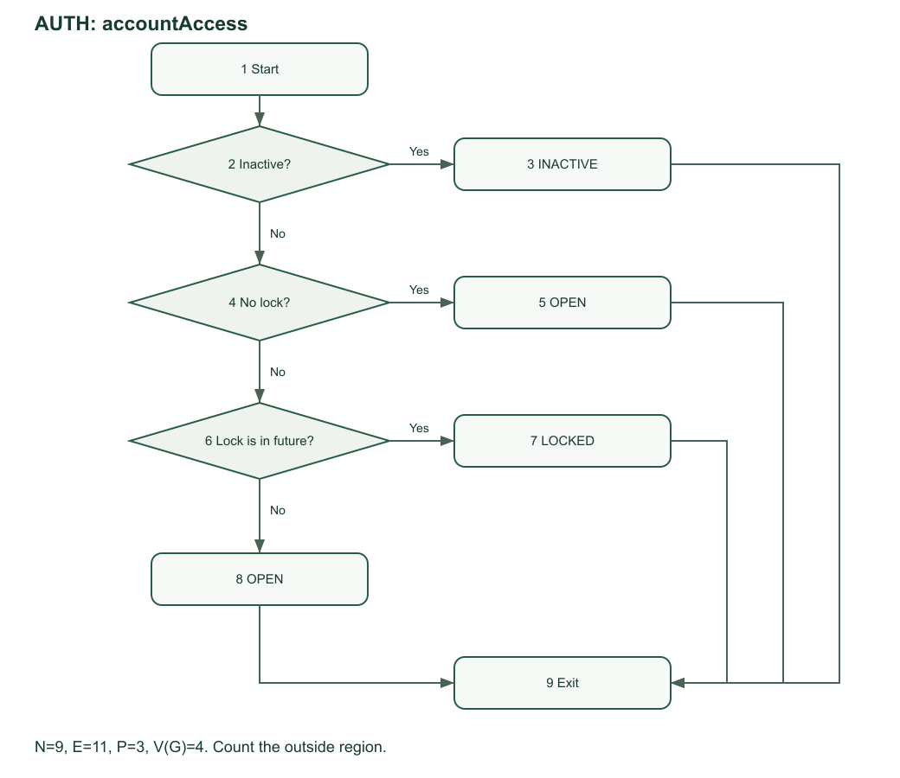

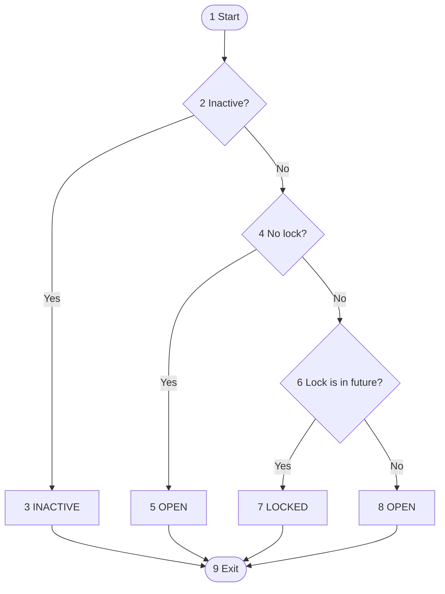

N = 9, E = 11, P = 3.

1. Edges and nodes: 11 - 9 + 2 = **4**.
2. Predicate nodes: 3 + 1 = **4**.
3. Regions: 3 bounded regions + 1 outside region = **4**.

| Path | Nodes | Test input and expected result |
|---|---|---|
| AUTH P1 | 1,2,3,9 | Inactive account |
| AUTH P2 | 1,2,4,5,9 | Active, no lock |
| AUTH P3 | 1,2,4,6,7,9 | Active, future lock |
| AUTH P4 | 1,2,4,6,8,9 | Active, expired lock |

Pseudocode:

```text
START
IF Inactive? THEN RETURN INACTIVE
IF No lock? THEN RETURN OPEN
IF Lock is in future? THEN RETURN LOCKED
RETURN OPEN
END
```

Production routine:

```typescript
export function accountAccess(
  active: boolean,
  lockedUntil: Date | string | null,
  now: number,
): "INACTIVE" | "LOCKED" | "OPEN" {
  if (!active) return "INACTIVE";
  if (lockedUntil === null) return "OPEN";
  if (new Date(lockedUntil).getTime() > now) return "LOCKED";
  return "OPEN";
}
```

## PHOTO: validatePhotoSize

Source: [src/lib/domain.ts:258](../src/lib/domain.ts).

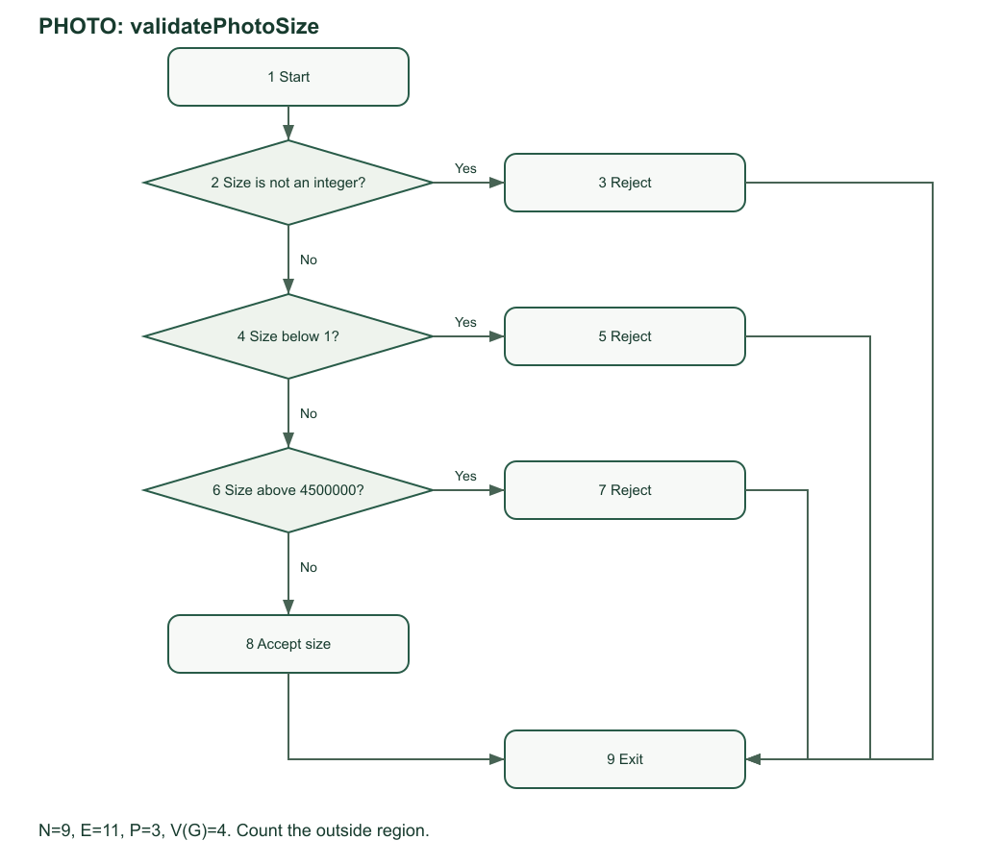

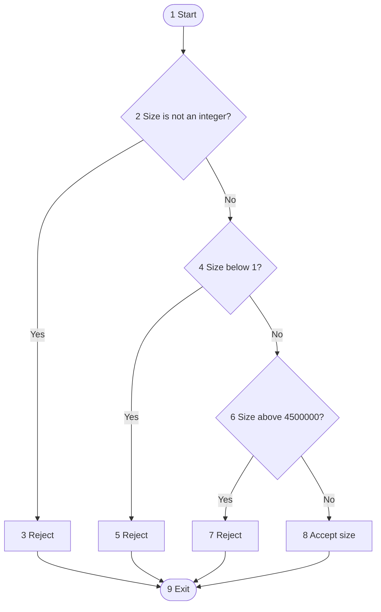

N = 9, E = 11, P = 3.

1. Edges and nodes: 11 - 9 + 2 = **4**.
2. Predicate nodes: 3 + 1 = **4**.
3. Regions: 3 bounded regions + 1 outside region = **4**.

| Path | Nodes | Test input and expected result |
|---|---|---|
| PHOTO P1 | 1,2,3,9 | 1.5 bytes |
| PHOTO P2 | 1,2,4,5,9 | 0 bytes |
| PHOTO P3 | 1,2,4,6,7,9 | 4500001 bytes |
| PHOTO P4 | 1,2,4,6,8,9 | 4500000 bytes |

Pseudocode:

```text
START
IF Size is not an integer? THEN REJECT input and exit
IF Size below 1? THEN REJECT input and exit
IF Size above 4500000? THEN REJECT input and exit
ACCEPT the size
END
```

Production routine:

```typescript
export function validatePhotoSize(size: number) {
  if (!Number.isInteger(size))
    throw new AppError("The photo size must be a whole number of bytes.");
  if (size < 1) throw new AppError("The photo cannot be empty.");
  if (size > MAX_PHOTO_BYTES)
    throw new AppError("The photo must be 4.5 MB or smaller.");
}
```

## DISPATCH: priorityHours

Source: [src/lib/policies.ts:14](../src/lib/policies.ts).

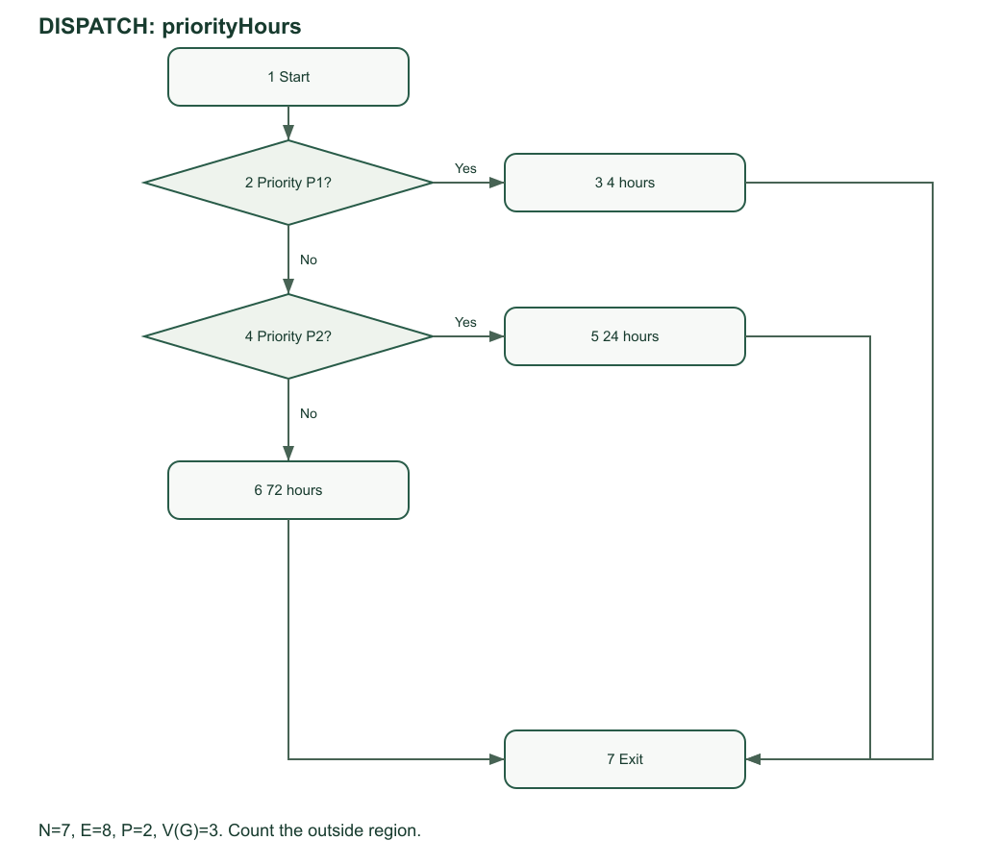

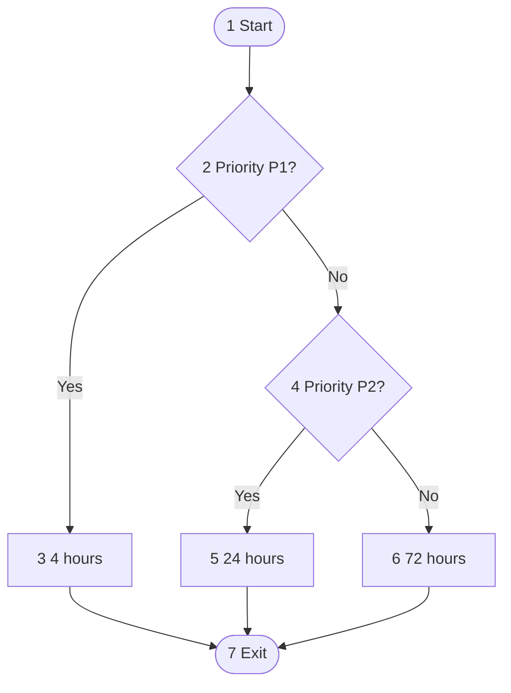

N = 7, E = 8, P = 2.

1. Edges and nodes: 8 - 7 + 2 = **3**.
2. Predicate nodes: 2 + 1 = **3**.
3. Regions: 2 bounded regions + 1 outside region = **3**.

| Path | Nodes | Test input and expected result |
|---|---|---|
| DISPATCH P1 | 1,2,3,7 | P1_CRITICAL |
| DISPATCH P2 | 1,2,4,5,7 | P2_URGENT |
| DISPATCH P3 | 1,2,4,6,7 | P3_ROUTINE |

Pseudocode:

```text
START
IF Priority P1? THEN RETURN 4 hours
IF Priority P2? THEN RETURN 24 hours
RETURN 72 hours
END
```

Production routine:

```typescript
export function priorityHours(priority: Priority) {
  if (priority === "P1_CRITICAL") return 4;
  if (priority === "P2_URGENT") return 24;
  return 72;
}
```

## REPAIR: completionDecision

Source: [src/lib/policies.ts:19](../src/lib/policies.ts).

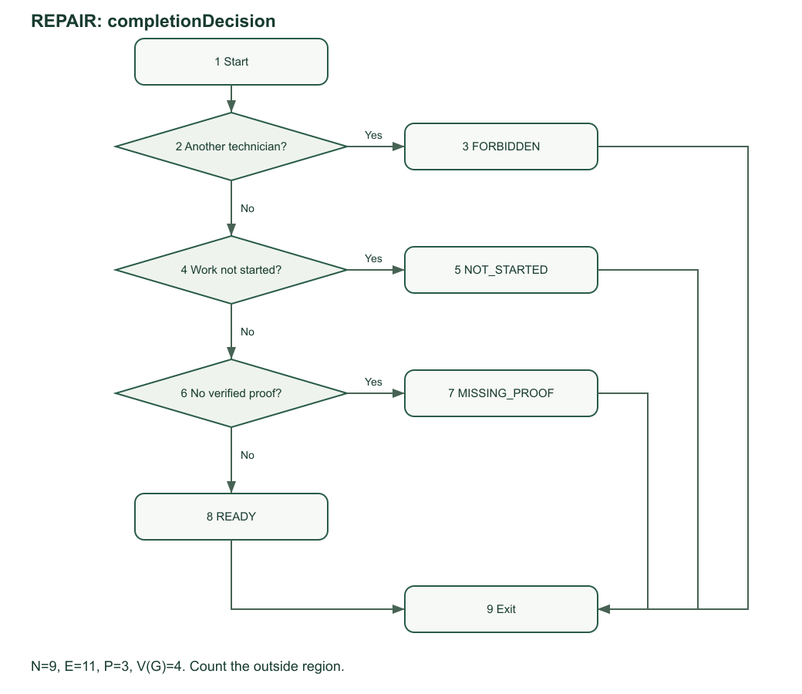

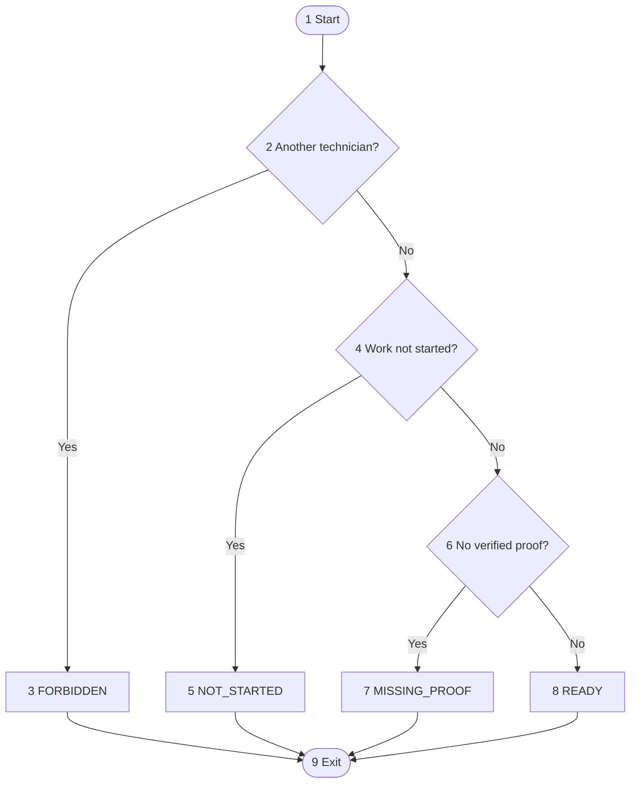

N = 9, E = 11, P = 3.

1. Edges and nodes: 11 - 9 + 2 = **4**.
2. Predicate nodes: 3 + 1 = **4**.
3. Regions: 3 bounded regions + 1 outside region = **4**.

| Path | Nodes | Test input and expected result |
|---|---|---|
| REPAIR P1 | 1,2,3,9 | Other technician |
| REPAIR P2 | 1,2,4,5,9 | Assigned state |
| REPAIR P3 | 1,2,4,6,7,9 | In progress, no proof |
| REPAIR P4 | 1,2,4,6,8,9 | In progress, proof present |

Pseudocode:

```text
START
IF Another technician? THEN RETURN FORBIDDEN
IF Work not started? THEN RETURN NOT_STARTED
IF No verified proof? THEN RETURN MISSING_PROOF
RETURN READY
END
```

Production routine:

```typescript
export function completionDecision(
  assignedTechId: string | null,
  actorId: string,
  status: TicketStatus,
  verifiedPhoto: boolean,
): "FORBIDDEN" | "NOT_STARTED" | "MISSING_PROOF" | "READY" {
  if (assignedTechId !== actorId) return "FORBIDDEN";
  if (status !== "IN_PROGRESS") return "NOT_STARTED";
  if (!verifiedPhoto) return "MISSING_PROOF";
  return "READY";
}
```

## NOTIFY: deliveryChannels

Source: [src/lib/policies.ts:30](../src/lib/policies.ts).

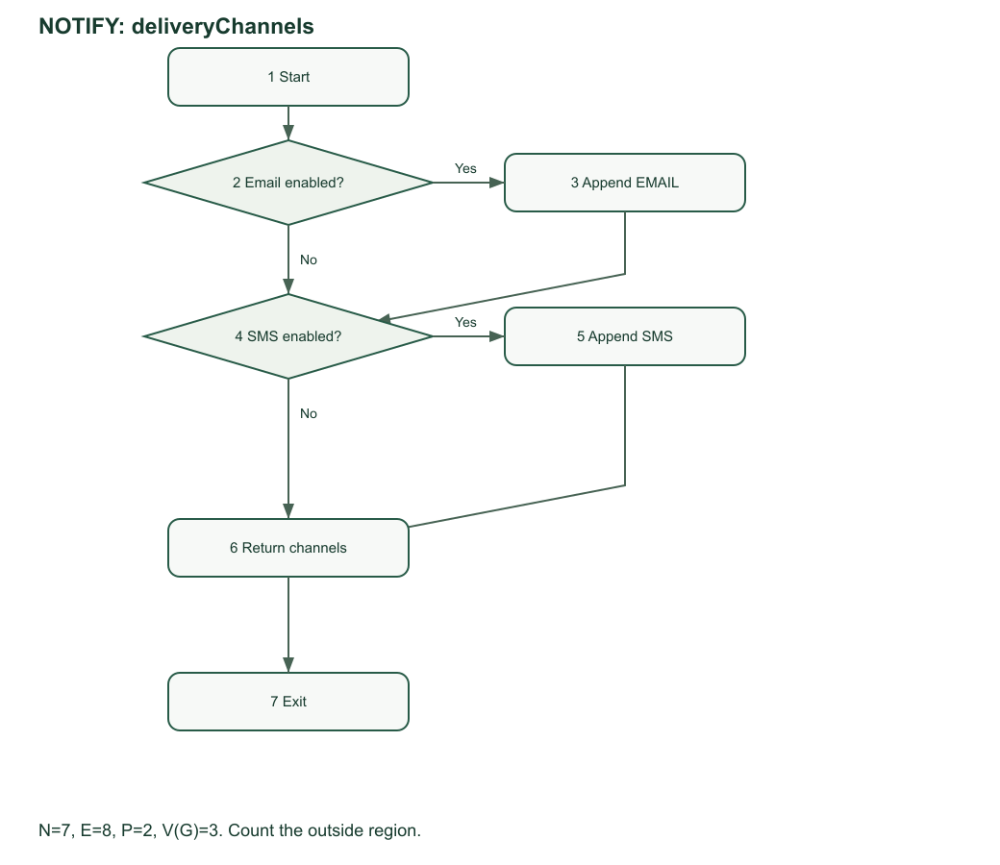

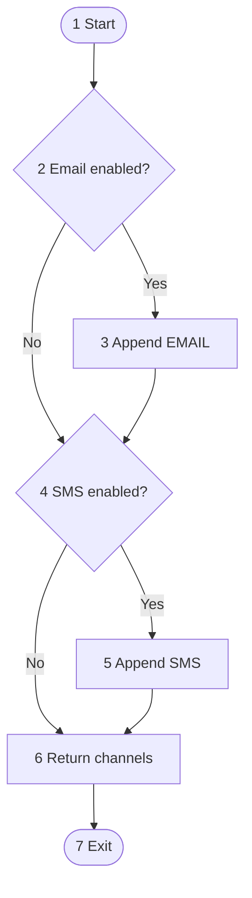

N = 7, E = 8, P = 2.

1. Edges and nodes: 8 - 7 + 2 = **3**.
2. Predicate nodes: 2 + 1 = **3**.
3. Regions: 2 bounded regions + 1 outside region = **3**.

| Path | Nodes | Test input and expected result |
|---|---|---|
| NOTIFY P1 | 1,2,4,6,7 | false, false => [] |
| NOTIFY P2 | 1,2,3,4,6,7 | true, false => EMAIL |
| NOTIFY P3 | 1,2,4,5,6,7 | false, true => SMS |

Pseudocode:

```text
SET channels to an empty list
IF Email enabled? THEN Append EMAIL
IF SMS enabled? THEN Append SMS
Return channels
END
```

Production routine:

```typescript
export function deliveryChannels(email: boolean, sms: boolean) {
  const channels: ("EMAIL" | "SMS")[] = [];
  if (email) channels.push("EMAIL");
  if (sms) channels.push("SMS");
  return channels;
}
```

## CSV: csvCell

Source: [src/lib/reports.ts:67](../src/lib/reports.ts).

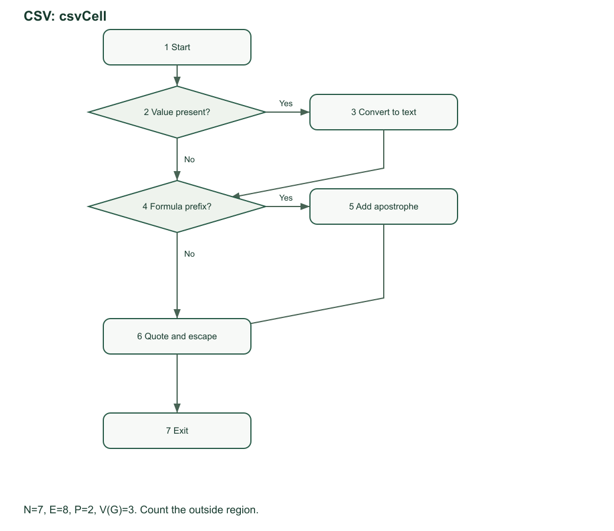

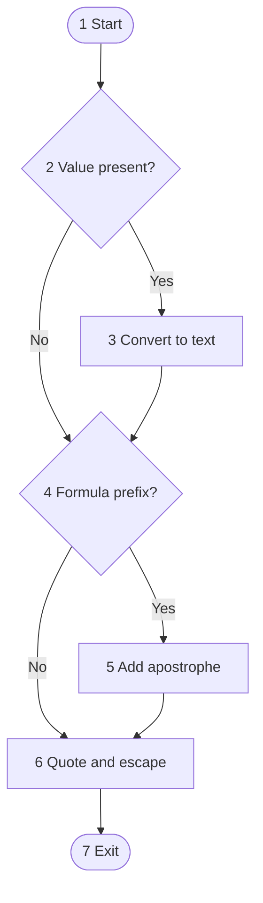

N = 7, E = 8, P = 2.

1. Edges and nodes: 8 - 7 + 2 = **3**.
2. Predicate nodes: 2 + 1 = **3**.
3. Regions: 2 bounded regions + 1 outside region = **3**.

| Path | Nodes | Test input and expected result |
|---|---|---|
| CSV P1 | 1,2,4,6,7 | null => empty quoted cell |
| CSV P2 | 1,2,3,4,6,7 | Plain text => quoted text |
| CSV P3 | 1,2,3,4,5,6,7 | =HYPERLINK(1) => escaped formula |

Pseudocode:

```text
SET text to an empty string
IF Value present? THEN Convert to text
IF Formula prefix? THEN Add apostrophe
Quote and escape
END
```

Production routine:

```typescript
export function csvCell(value: unknown) {
  let text = "";
  if (value != null) text = String(value);
  if (/^[=+\-@\t\r]/.test(text)) text = "'" + text;
  return '"' + text.replaceAll('"', '""') + '"';
}
```

The NOTIFY suite also tests both channels together. The CSV formula path passes through the value conversion node before the formula guard. The empty-value path cannot reach the formula branch because its text is empty. The tests include exact lock expiry and the full description and image boundaries.

Run `npm run docs:whitebox`, then `npm run test:coverage`. See [test results](evidence/Test_Results.md). A failed test or changed decision count requires a new review.